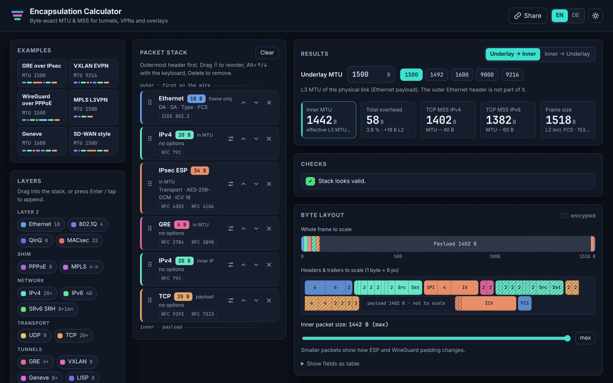
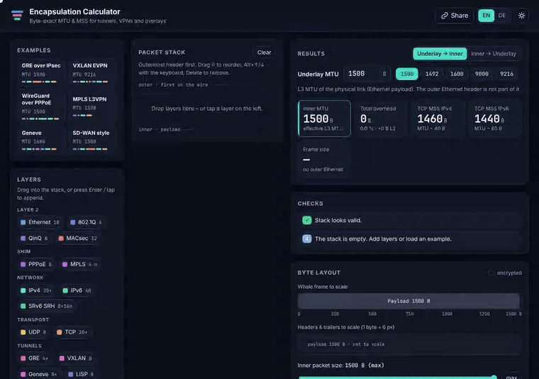

# Encapsulation Calculator

**Byte-exact MTU, MSS and frame size for tunnels, VPNs and overlays.** Stack the headers, see the packet, copy the config.

A single, self-contained `index.html`: no installation, no backend, no CDN, no tracking. Download it and double-click it. It works offline.





## Features

- **Build the stack with drag & drop.** Drag layers from the palette, reorder them and drag them out to remove them. This works with mouse, touch (long-press a chip, or drag the ⠿ handle) and keyboard (Enter adds, Alt+↑/↓ moves, Delete removes).
- **Byte layout to scale.** One bar shows the whole frame to scale. Below it, every header and trailer field is drawn at 1 byte = 8 px, with tooltips on every field and a hatch pattern for encrypted parts. You can also view the fields as a table.
- **Underlay MTU** is adjustable, with presets 1500, 1492, 1600, 9000 and 9216.
- **Results:** total overhead, effective inner MTU, recommended TCP MSS for IPv4 and IPv6, L2 frame size and size on the wire (preamble + IPG).
- **Reverse mode:** enter the inner MTU you want and get the smallest underlay MTU that delivers it. ESP block alignment is taken into account.
- **Padding explorer:** shrink the inner packet to see how ESP and WireGuard padding changes.
- **Config snippets** for Cisco IOS, Linux (ip link, iptables, nftables, wg-quick), MikroTik RouterOS and Juniper Junos. They only use documented syntax (see [Sources](#sources)).
- **Examples:** GRE over IPsec, VXLAN EVPN, WireGuard over PPPoE, MPLS L3VPN, Geneve, SD-WAN-style IPsec with NAT-T.
- **Share by URL:** the complete state lives in the URL hash, e.g. `index.html#m=1500&s=eth_ipv4_udp_vxlan_eth_ipv4`.
- **Plain-language checks:** wrong layer order, VXLAN without an inner Ethernet header, inner MTU below 1280 for IPv6 or below 576 for IPv4, oversized frames, MACsec frame growth, weak ICV lengths and more.
- **Dark and light mode, English and German.** The layout is responsive and has a summary bar on phones.
- **Accessible:** labelled controls, live announcements for stack changes, keyboard navigation through the byte map, sufficient contrast and `prefers-reduced-motion` support.

### Layers and options

| Layer | Options |
|---|---|
| Ethernet, 802.1Q, QinQ | – |
| MACsec | with / without explicit SCI |
| PPPoE | – |
| MPLS | number of labels |
| SRv6 (SRH) | number of SIDs, reduced encapsulation |
| IPv4 | options length (0–40 B) |
| IPv6 | – |
| UDP | – |
| TCP | Timestamps option |
| GRE | Checksum, Key, Sequence (each on its own) |
| VXLAN, LISP | – |
| Geneve | options length (0–252 B) |
| IPsec ESP | tunnel / transport, NAT-T, AES-CBC / AES-GCM / ChaCha20-Poly1305, key length, ICV length (GCM), integrity algorithm (CBC) |
| WireGuard | outer IPv4/IPv6 taken from the stack, 16-byte padding |

## How the calculation works

The stack is ordered from the outermost header (first on the wire) to the innermost one.

1. **L3 MTU vs. frame.** Leading Ethernet, 802.1Q, QinQ and MACsec headers make up the *frame*. They are **not** part of the MTU. The underlay MTU is the Ethernet payload size (1500 on standard Ethernet).
2. **Everything after that sits inside the underlay MTU:** PPPoE, MPLS, outer IP, UDP, tunnel headers, inner Ethernet (14 B, without FCS) and so on.
3. **Inner MTU** is the space left for the innermost IP header, meaning the IP header that only carries TCP/UDP or nothing.
4. **MSS** = inner MTU − 40 (IPv4) or − 60 (IPv6). IPv4 options on the inner header are subtracted too. TCP Timestamps reduce the data per segment by another 12 B, and the tool shows that separately.
5. **ESP** is not a fixed overhead. The encrypted part (payload + padding + Pad Length + Next Header) has to be a multiple of the cipher block size: 16 B for AES-CBC, 4 B for AES-GCM and ChaCha20-Poly1305. The tool computes `floor((capacity − SPI − Seq − IV − ICV − NAT-T) / block) × block − 2`.
6. **WireGuard** pads the plaintext to a multiple of 16 B, but never beyond the interface MTU (Linux `send.c`). The maximum inner MTU is therefore capacity − 32. Padding only shows up for smaller packets.
7. **Reverse mode** uses a binary search for the smallest underlay MTU whose inner MTU is ≥ the target.

### Verified reference values (underlay 1500, inner IPv4)

| Stack | Inner MTU | MSS |
|---|---|---|
| GRE over IPv4, no options | 1476 | 1436 |
| VXLAN over IPv4 | 1450 | 1410 |
| PPPoE | 1492 | 1452 |
| MPLS, 2 labels | 1492 | 1452 |
| WireGuard over IPv4 | 1440 | 1400 |
| WireGuard over IPv6 | 1420 | 1380 |
| ESP tunnel AES-256-GCM (IV 8, ICV 16), IPv4, no NAT-T | 1446 | 1406 |
| ESP tunnel AES-256-CBC + HMAC-SHA-256-128, IPv4, no NAT-T | 1438 | 1398 |
| GRE over IPv4, inner IPv6 | 1476 | 1416 (IPv6) |

All of these are covered by automated tests.

## Sources

Every overhead value in the code (`src/calc.js`, `REFS`) and in the tool (badges on each layer, *Sources* panel) is linked to its source.

| Value | Source |
|---|---|
| Ethernet 14 B + FCS 4 B, preamble 8 B, IPG 12 B, 1500 B payload | IEEE 802.3 |
| 802.1Q / 802.1ad tag 4 B each | IEEE 802.1Q |
| MACsec SecTAG 8 B / 16 B with SCI, ICV 16 B | IEEE 802.1AE; [Cisco xrdocs MACsec overview](http://xrdocs.io/ncs5500/tutorials/macsec-on-ncs-5500-technology-and-platform-overview) |
| PPPoE 6 B + PPP 2 B; MTU > 1492 | [RFC 2516](https://www.rfc-editor.org/rfc/rfc2516), [RFC 4638](https://www.rfc-editor.org/rfc/rfc4638) |
| MPLS 4 B per label | [RFC 3032](https://www.rfc-editor.org/rfc/rfc3032) |
| IPv4 20 B + options, 576 / 68 B minimums | [RFC 791](https://www.rfc-editor.org/rfc/rfc791) |
| IPv6 40 B, minimum MTU 1280 | [RFC 8200](https://www.rfc-editor.org/rfc/rfc8200) |
| SRH 8 B + 16 B per SID; reduced encapsulation | [RFC 8754](https://www.rfc-editor.org/rfc/rfc8754), [RFC 8986](https://www.rfc-editor.org/rfc/rfc8986) |
| UDP 8 B | [RFC 768](https://www.rfc-editor.org/rfc/rfc768) |
| TCP 20 B, Timestamps 10 B (+2 NOP) | [RFC 9293](https://www.rfc-editor.org/rfc/rfc9293), [RFC 7323](https://www.rfc-editor.org/rfc/rfc7323) |
| MSS = MTU − IP − TCP | [RFC 6691](https://www.rfc-editor.org/rfc/rfc6691) |
| GRE 4 B, Checksum/Key/Sequence 4 B each | [RFC 2784](https://www.rfc-editor.org/rfc/rfc2784), [RFC 2890](https://www.rfc-editor.org/rfc/rfc2890) |
| VXLAN 8 B | [RFC 7348](https://www.rfc-editor.org/rfc/rfc7348) |
| Geneve 8 B + options | [RFC 8926](https://www.rfc-editor.org/rfc/rfc8926) |
| LISP 8 B | [RFC 9300](https://www.rfc-editor.org/rfc/rfc9300) |
| ESP header/trailer, padding rules | [RFC 4303](https://www.rfc-editor.org/rfc/rfc4303) |
| AES-CBC IV 16 B, block 16 B | [RFC 3602](https://www.rfc-editor.org/rfc/rfc3602) |
| AES-GCM IV 8 B, ICV 16 (8/12) B | [RFC 4106](https://www.rfc-editor.org/rfc/rfc4106) |
| ChaCha20-Poly1305 IV 8 B, ICV 16 B | [RFC 7634](https://www.rfc-editor.org/rfc/rfc7634) |
| HMAC-SHA-256-128 / -384-192 / -512-256 | [RFC 4868](https://www.rfc-editor.org/rfc/rfc4868) |
| HMAC-SHA-1-96 | [RFC 2404](https://www.rfc-editor.org/rfc/rfc2404) |
| ESP algorithm recommendations | [RFC 8221](https://www.rfc-editor.org/rfc/rfc8221) |
| NAT-T UDP 8 B | [RFC 3948](https://www.rfc-editor.org/rfc/rfc3948) |
| WireGuard 16 B header + 16 B tag, 16 B padding | [WireGuard whitepaper](https://www.wireguard.com/papers/wireguard.pdf), Linux `drivers/net/wireguard` (`messages.h`, `send.c`) |
| wg-quick default MTU 1420 (= 1500 − 80) | [wireguard-tools discussion](https://lists.zx2c4.com/pipermail/wireguard/2023-November/008251.html) |

Configuration syntax:

- Cisco IOS: [IP Application Services Command Reference](https://www.cisco.com/en/US/docs/ios-xml/ios/ipapp/command/iap-i2.html) (`ip tcp adjust-mss` 500–1460, `ipv6 tcp adjust-mss` 40–1940)
- Linux: [ip-link(8)](https://man7.org/linux/man-pages/man8/ip-link.8.html), [iptables-extensions(8) TCPMSS](https://ipset.netfilter.org/iptables-extensions.man.html), [nftables wiki: Mangling packet headers](https://wiki.nftables.org/wiki-nftables/index.php/Mangling_packet_headers)
- MikroTik: [/ip firewall mangle](https://manual.mikrotik.com/docs/7.25/cli-reference/ip/firewall/mangle/), [/ipv6 firewall mangle](https://manual.mikrotik.com/docs/7.25/cli-reference/ipv6/firewall/mangle/)
- Juniper: [Media MTU (includes the L2 header)](https://juniper.net/documentation/us/en/software/junos/interfaces-fundamentals/topics/topic-map/media-mtu.html), [security flow tcp-mss](https://juniper.net/documentation/en_US/junos12.1x46/topics/reference/configuration-statement/security-edit-tcp-mss.html)

## Development

The tool itself needs nothing. For development you only need Node.js ≥ 18. Browser tests also need Playwright.

```
src/calc.js        calculation core (pure functions, no DOM) – also a Node module
src/config.js      config snippet generator (pure)
src/i18n.js        English / German strings
src/app.js         user interface
src/styles.css     styles
src/template.html  page skeleton
build.js           inlines everything into index.html
test/calc.test.js  unit tests (node:test, no dependencies)
test/e2e.js        browser tests (Playwright, Chromium)
scripts/record-demo.js  screenshot + demo GIF/MP4 (Playwright + ffmpeg)
```

```bash
npm test            # unit tests
npm run build       # rebuild index.html from src/
npm run test:e2e    # build + browser tests (needs: npm i -D playwright && npx playwright install chromium)
```

Always edit `src/`, then run `npm run build`. `index.html` is a generated file, but it is committed so GitHub Pages can serve it directly.

## Limitations

- IPv6 extension headers other than the SRH, IPv4/IPv6 fragmentation, ESP TFC padding, ESP implicit IV ([RFC 8750](https://www.rfc-editor.org/rfc/rfc8750)) and vendor-specific SD-WAN headers are not modelled.
- Config snippets use placeholder interface names. Check them against your platform and software version before you use them.

## License

[MIT](LICENSE)
